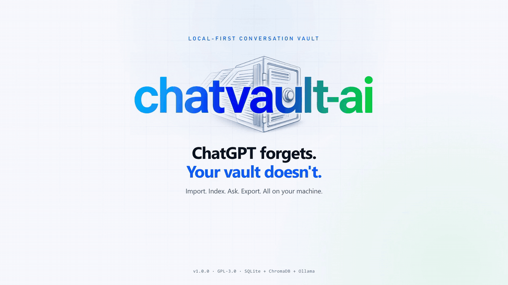

<p align="center">
  
</p>

# ChatVault AI

[](https://github.com/makitdev/chatvault-ai/actions/workflows/ci.yml)
[](https://github.com/makitdev/chatvault-ai/releases)
[](LICENSE)

ChatVault AI imports public ChatGPT shared conversations, stores them in
SQLite, exports them as PDF/DOCX, and builds a local searchable vector index
with Ollama embeddings and ChromaDB. A React frontend adds a dashboard, an
import workflow, a searchable library, a conversation viewer, settings, and a
retrieval-augmented AI chat that cites its sources.

SQLite is the source of truth. ChromaDB is a derived index and can be rebuilt
from SQLite at any time. Answers are generated by a local Ollama model; no
conversation text is sent to a hosted model.

## Demo

<p align="center">
  
</p>

Import a public ChatGPT share link, index it locally, ask a question with cited
sources, and export the conversation as PDF or DOCX — all without sending
conversation text to a hosted model.

## Requirements

- Python **3.13** (Python 3.14 is not supported yet because `grpcio` has no
  cp314 wheel for ChromaDB).
- Node.js **20+** and npm for the frontend.
- [Ollama](https://ollama.com/) reachable at `http://localhost:11434`.
- The embedding and chat models:

  ```bash
  ollama pull nomic-embed-text
  ollama pull llama3.2:3b
  ```

## Setup

### Backend

```bash
uv venv --python 3.13 .venv
uv pip install --python .venv/bin/python -r requirements.txt
cp .env.example .env
```

The default `.env` values work for local development:

```dotenv
OLLAMA_BASE_URL=http://localhost:11434
OLLAMA_CHAT_MODEL=llama3.2:3b
OLLAMA_CHAT_TIMEOUT=180
OLLAMA_CHAT_TEMPERATURE=0.2
OLLAMA_EMBED_MODEL=nomic-embed-text
OLLAMA_EMBED_TIMEOUT=120
OLLAMA_EMBED_BATCH_SIZE=16

CORS_ORIGINS=["http://localhost:5173","http://127.0.0.1:5173"]

CHAT_TOP_K=5
CHAT_MAX_HISTORY_MESSAGES=10
CHAT_MAX_CONTEXT_CHARS=12000

CHROMA_DB_PATH=storage/chroma
CHROMA_COLLECTION_NAME=chatvault_conversations
CHROMA_TELEMETRY=false

DATABASE_URL=sqlite:///./storage/chatvault.db
SQL_ECHO=false

CHUNK_SIZE_TOKENS=500
CHUNK_OVERLAP_TOKENS=75
CHUNK_MIN_TOKENS=30
CHUNKING_VERSION=message-aware-v1
```

`CORS_ORIGINS` is a JSON array. Add the origins you serve the frontend from.

### Frontend

```bash
cd frontend
npm install
cp .env.example .env
```

`frontend/.env`:

```dotenv
VITE_API_BASE_URL=http://127.0.0.1:8000/api/v1
```

The backend and frontend setup above is also available as `make install`.

## Run

Start the backend:

```bash
.venv/bin/uvicorn app.main:app --reload
```

Or use the packaged launcher:

```bash
python run.py
# or: make run
```

`run.py` accepts `--host`, `--port`, `--reload`, and `--log-level`:

```bash
python run.py --host 0.0.0.0 --port 8000 --reload
```

Interactive API documentation: <http://127.0.0.1:8000/docs>

In a second terminal, start the frontend:

```bash
cd frontend
npm run dev
```

Open <http://127.0.0.1:5173>.

To serve a production frontend build:

```bash
cd frontend
npm run build
npm run preview
```

## Frontend pages

| Page | Purpose |
| --- | --- |
| Dashboard | Live conversation, message, chunk, vector, and index coverage stats plus recent imports. |
| AI Chat | Retrieval-augmented answers with source citations and follow-up history. |
| Library | Title search, sorting, filters, conversation viewer links, and deletion. |
| Import | Public ChatGPT share URL validation, import progress, automatic indexing, and retry. |
| Conversation | Full Markdown transcript with code highlighting, copy actions, and PDF/DOCX export. |
| Settings | Ollama/model availability, ChromaDB and SQLite status, index details, and full rebuild. |

## API

All routes are under `/api/v1`.

| Method | Path | Purpose |
| --- | --- | --- |
| `GET` | `/health` | Service health. |
| `POST` | `/import/url` | Fetch and store a public `chatgpt.com/share` conversation. |
| `GET` | `/conversations` | Paginated conversation list. Supports `skip` and `limit`. |
| `GET` | `/conversations/{conversation_id}` | Conversation detail with all messages. |
| `DELETE` | `/conversations/{conversation_id}` | Delete a conversation, its messages, and its vectors. |
| `GET` | `/conversations/{conversation_id}/export/pdf` | Export a conversation as PDF. |
| `GET` | `/conversations/{conversation_id}/export/docx` | Export a conversation as DOCX. |
| `POST` | `/index/{conversation_id}` | Index one conversation. Use `?force=true` to reindex. |
| `POST` | `/index/all` | Index all conversations. Supports `limit`, `force`, and `fail_fast`. |
| `GET` | `/index/status` | Collection, model, chunking, and conversation counts. |
| `POST` | `/index/rebuild` | Delete and recreate the collection, then reindex everything. |
| `DELETE` | `/index/{conversation_id}` | Remove one conversation's vectors and reset its state. |
| `GET` | `/stats` | Dashboard totals, index health, and the five most recent imports. |
| `POST` | `/search` | Semantic search across indexed chunks. |
| `POST` | `/chat` | Retrieval-augmented answer with cited sources. |
| `GET` | `/models/status` | Ollama availability, configured models, ChromaDB, SQLite, and index summary. |

### Import and manage conversations

```bash
curl -X POST http://127.0.0.1:8000/api/v1/import/url \
  -H 'Content-Type: application/json' \
  -d '{"url":"https://chatgpt.com/share/<share-id>"}'

curl http://127.0.0.1:8000/api/v1/conversations
curl http://127.0.0.1:8000/api/v1/conversations/<conversation-id>
curl -X DELETE http://127.0.0.1:8000/api/v1/conversations/<conversation-id>
```

Deleting a conversation removes its SQLite records and its derived vectors. If
ChromaDB is temporarily unavailable, the SQLite deletion still succeeds and
search ignores any orphaned vectors.

### Index

```bash
curl -X POST http://127.0.0.1:8000/api/v1/index/<conversation-id>
curl http://127.0.0.1:8000/api/v1/index/status
curl -X POST "http://127.0.0.1:8000/api/v1/index/all?limit=10"
curl -X POST http://127.0.0.1:8000/api/v1/index/rebuild
curl -X DELETE http://127.0.0.1:8000/api/v1/index/<conversation-id>
```

### Search

```bash
curl -X POST http://127.0.0.1:8000/api/v1/search \
  -H 'Content-Type: application/json' \
  -d '{"query":"reset the Shell-GPT API key","limit":5}'
```

Optional `conversation_id` restricts results to one conversation. Each result
includes the conversation title, speaker role, message position, chunk index,
text, and raw cosine distance.

### Chat

```bash
curl -X POST http://127.0.0.1:8000/api/v1/chat \
  -H 'Content-Type: application/json' \
  -d '{
    "message": "How do I install Shell-GPT?",
    "history": [
      {"role": "user", "content": "I am using Kali Linux."},
      {"role": "assistant", "content": "Understood."}
    ],
    "top_k": 5
  }'
```

The backend embeds the question, retrieves the closest indexed chunks, and
asks the configured Ollama chat model to answer using only those passages.
Responses include:

- `status`: `answered` or `no_sources`.
- `answer`: the Markdown answer.
- `model`: the Ollama model that answered, or `null`.
- `sources`: numbered chunks with conversation metadata and text.

If retrieval finds no indexed sources, the backend returns
`status: "no_sources"` without calling the chat model. `top_k` is clamped to
1–10; history is trimmed according to `CHAT_MAX_HISTORY_MESSAGES`, and context
is capped by `CHAT_MAX_CONTEXT_CHARS`. The model is instructed to cite sources
as `[n]` and to ignore instructions found inside imported conversations.

## Indexing behavior

- **Message-aware chunking.** Chunks never cross message boundaries. Fenced
  code blocks are preserved where possible; oversized blocks are split and
  re-fenced. The defaults are 500 tokens, 75 tokens of overlap, and a 30-token
  minimum.
- **Approximate token counting.** Indexing uses a deterministic
  `approximate_char4` counter (four characters per token) instead of an exact
  tokenizer. Chunk sizes are therefore stable and approximate, which is
  sufficient for retrieval. `nomic-embed-text` uses its own tokenizer.
- **Explicit embeddings only.** Text is sent to Ollama's `/api/embed`
  endpoint in batches. ChromaDB's default embedding function is never used, so
  no ONNX model is downloaded and no telemetry is enabled.
- **Cosine distance.** Each conversation is stored in the
  `chatvault_conversations` collection. Search returns raw cosine distances.
- **Idempotency.** A conversation whose chunking/embedding signature is current
  returns `already_indexed`. Changing chunk settings marks existing entries as
  stale so they can be reindexed individually. Changing the embedding model or
  vector dimension requires a full rebuild.
- **Failure safety.** New embeddings are generated before old vectors are
  deleted. If embedding generation fails, the previous vectors remain in place
  and the index state is marked `failed`. Partial Chroma writes are cleaned up.
- **Startup reconciliation.** Any conversation left in `indexing` after a
  restart is marked `failed` with a diagnostic message.
- **Synchronous operation.** Indexing and chat run in the request. Background
  jobs are not implemented yet.

The derived index state is stored in the `conversation_index_states` SQLite
table. Deleting a conversation cascades its index state; its Chroma vectors can
be removed through the delete endpoint.

## Tests

```bash
.venv/bin/python -m pytest -q
```

The normal suite uses temporary SQLite databases, temporary Chroma directories,
and fake embedding/chat clients. It does not require Ollama.

To run the real Ollama index/retrieve test:

```bash
RUN_OLLAMA_TESTS=1 .venv/bin/python -m pytest tests/test_ollama_integration.py -q
```

This test skips unless `RUN_OLLAMA_TESTS=1`; when enabled it requires a running
Ollama instance with `nomic-embed-text` installed.

Frontend type-check and production build:

```bash
cd frontend
npm run build
```

## Privacy and local artifacts

- Conversation text is not written to application logs. Indexing and chat
  failures log conversation IDs and exception types only.
- `storage/chatvault.db`, `storage/chroma/`, generated documents, and `.env`
  files are ignored by Git.
- Remove `storage/chroma/` or call `POST /index/rebuild` to recreate the derived
  index from SQLite.
- Chat embeddings and generation run against the local Ollama service.

## Troubleshooting

**`Chat model 'llama3.2:3b' is not available`**

```bash
ollama pull llama3.2:3b
```

**`Embedding model 'nomic-embed-text' is not available`**

```bash
ollama pull nomic-embed-text
```

**`Ollama is unavailable`**

Start Ollama and confirm the API is reachable:

```bash
curl http://localhost:11434/api/tags
```

**The frontend cannot reach the API**

Confirm the backend is running on port 8000 and that
`frontend/.env` contains:

```dotenv
VITE_API_BASE_URL=http://127.0.0.1:8000/api/v1
```

**Browser requests are blocked by CORS**

Add the frontend origin to the backend `.env` as a JSON array, then restart the
backend:

```dotenv
CORS_ORIGINS=["http://localhost:5173","http://127.0.0.1:5173"]
```

**`The embedding model has changed. Rebuild the index.`**

The collection was built with another model. Rebuild it:

```bash
curl -X POST http://127.0.0.1:8000/api/v1/index/rebuild
```

**Chroma dependency install fails on Python 3.14**

Recreate the virtual environment with Python 3.13:

```bash
uv venv --python 3.13 --clear .venv
uv pip install --python .venv/bin/python -r requirements.txt
```

## Development

```bash
make check
```

runs Python compilation, frontend linting, the backend tests, and the production
frontend build. Individual targets:

```bash
make test          # backend pytest suite
make test-ollama   # opt-in real Ollama integration test
make lint          # Python compile check + frontend oxlint
make build         # production frontend build
make run           # start the backend with run.py
make dev           # start uvicorn with auto-reload
```

The Python package can also be installed in editable mode:

```bash
uv pip install --python .venv/bin/python -e ".[dev]"
chatvault --version
```

See [CONTRIBUTING.md](CONTRIBUTING.md) for the full development workflow and
[RELEASE.md](RELEASE.md) for the release checklist.

## Contributing

Contributions are welcome. Read [CONTRIBUTING.md](CONTRIBUTING.md) and follow the
[Code of Conduct](CODE_OF_CONDUCT.md). For security issues, follow
[SECURITY.md](SECURITY.md) instead of opening a public issue.

## License

ChatVault AI is licensed under the
[GNU General Public License v3.0](LICENSE).
