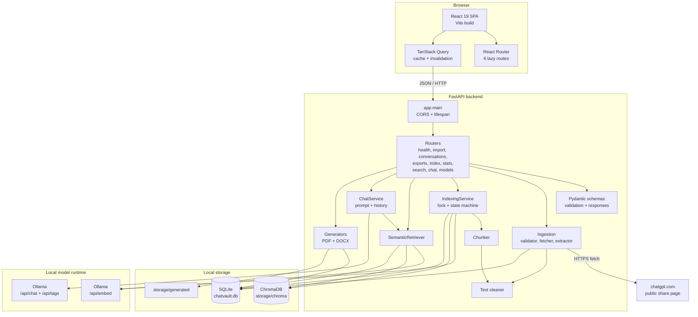

# Architecture

ChatVault AI is a local two-process application: a FastAPI backend that owns all
data and model access, and a React single-page frontend that talks to it over
HTTP.

There is no hosted service, message queue, worker process, or authentication
layer in `v1.0.0`. Every operation runs inside the backend request that triggered
it.

## Component map

## Backend layers

### Presentation

`app/main.py` creates the FastAPI application, enables CORS, and includes every
router under `settings.API_V1_PREFIX` (default `/api/v1`). It also defines the
root `GET /` status document and the OpenAPI endpoints at `/docs` and
`/openapi.json`.

Routers translate domain exceptions into HTTP status codes. They do not contain
retrieval or generation logic.

### Validation

`app/api/schemas.py` defines every request and response model. Pydantic enforces
string lengths, numeric ranges, literal values, and URL types. FastAPI returns
HTTP `422` for validation failures before a route body runs.

### Domain modules

| Module | Responsibility |
| --- | --- |
| `app/ingestion/` | URL validation, safe fetch, payload extraction, HTML fallback |
| `app/processing/` | Annotation cleaning, message-aware chunking, index state |
| `app/embeddings/` | Ollama embedding client, batching, retries, validation |
| `app/vectorstore/` | ChromaDB adapter, provenance, upsert, query, delete |
| `app/rag/` | Retrieval, prompt assembly, Ollama chat client |
| `app/generators/` | PDF and DOCX rendering |
| `app/database/` | SQLAlchemy models, engine, session, repository queries |

### Persistence

SQLite holds three tables:

- `conversations`
- `messages`
- `conversation_index_states`

Messages and index state cascade-delete with their conversation. SQLite is the
source of truth. ChromaDB holds derived vectors and is rebuilt from SQLite.

### Lifespan

On startup, the lifespan handler:

1. Calls `init_db()` to create tables.
2. Opens a session.
3. Marks any conversation left in `indexing` as `failed` with
   `Indexing was interrupted before completion.`

This prevents a server restart from leaving a stuck indexing state.

## Frontend layers

| Layer | Files | Responsibility |
| --- | --- | --- |
| Routing | `src/App.tsx` | Six lazy-loaded routes plus a not-found route |
| Shell | `src/components/layout/` | Sidebar, header, responsive navigation |
| Pages | `src/pages/` | Dashboard, AI Chat, Library, Import, Conversation, Settings, NotFound |
| Data | `src/hooks/queries.ts` | TanStack Query hooks, cache keys, invalidation |
| Services | `src/services/` | Typed axios calls and error normalization |
| Rendering | `src/components/common/Markdown.tsx` | Markdown, GFM, code highlighting, copy buttons |

The frontend holds no persistent chat history. AI Chat messages live in React
state and disappear on reload.

## Concurrency model

- The backend is designed for a single local process.
- `IndexingService` uses a process-wide non-blocking `threading.Lock`. A second
  indexing operation receives HTTP `409` rather than running concurrently.
- FastAPI runs synchronous route functions in a thread pool, so the lock prevents
  overlap within one process.
- Multiple backend processes pointed at the same SQLite and ChromaDB directories
  are not coordinated and are not a supported deployment.

## Failure boundaries

| Failure | Effect |
| --- | --- |
| Ollama unavailable | Indexing, search, and chat return `503`; the library and export still work |
| Embedding model missing | Indexing and search return `503` |
| Chat model missing | Chat returns `503`; search still works |
| ChromaDB unavailable | Index status reports unavailable; search/chat return `503`; delete still removes SQLite data |
| ChromaDB incompatible | Indexing, search, and chat return `409` until rebuild |
| Embedding model changed | Existing vectors are rejected with `409` until rebuild |
| Import fetch fails | `502`; nothing is stored |
| Extraction fails | `502`; nothing is stored |
| SQLite write fails | Import returns `500`; export may also fail |
| PDF font missing | PDF export returns `500`; DOCX still works |

The application favors keeping the durable record. If vector cleanup fails during
conversation deletion, SQLite deletion still succeeds. Orphaned vectors are
filtered by checking conversation IDs against SQLite during retrieval.

## What the architecture deliberately omits

- Authentication, users, roles, and tenant isolation.
- Background workers, task queues, and progress streams.
- Streaming chat responses.
- Hosted model or vector providers.
- Server-side rendering and a Node production server.
- Database migrations. Tables are created at startup with
  `Base.metadata.create_all`.

## Related pages

- [Data Flow](data-flow.md)
- [RAG Explained](rag-explained.md)
- [Local-First Design](local-first-design.md)
- [Project Structure](../development/project-structure.md)
