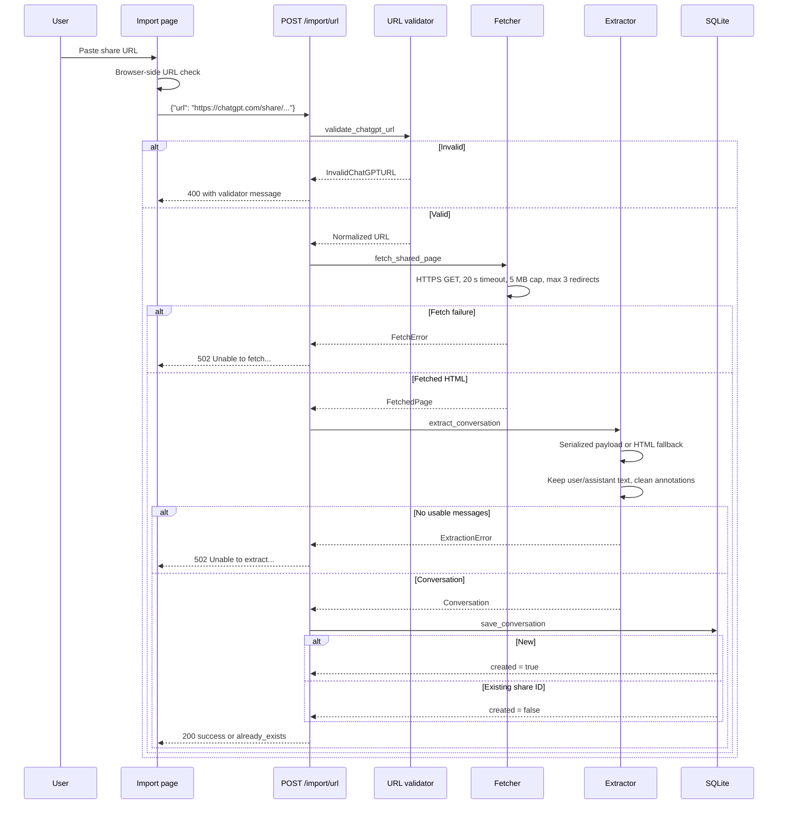
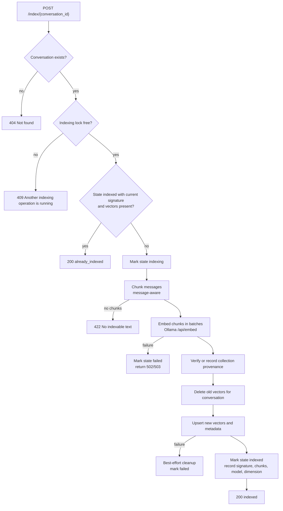
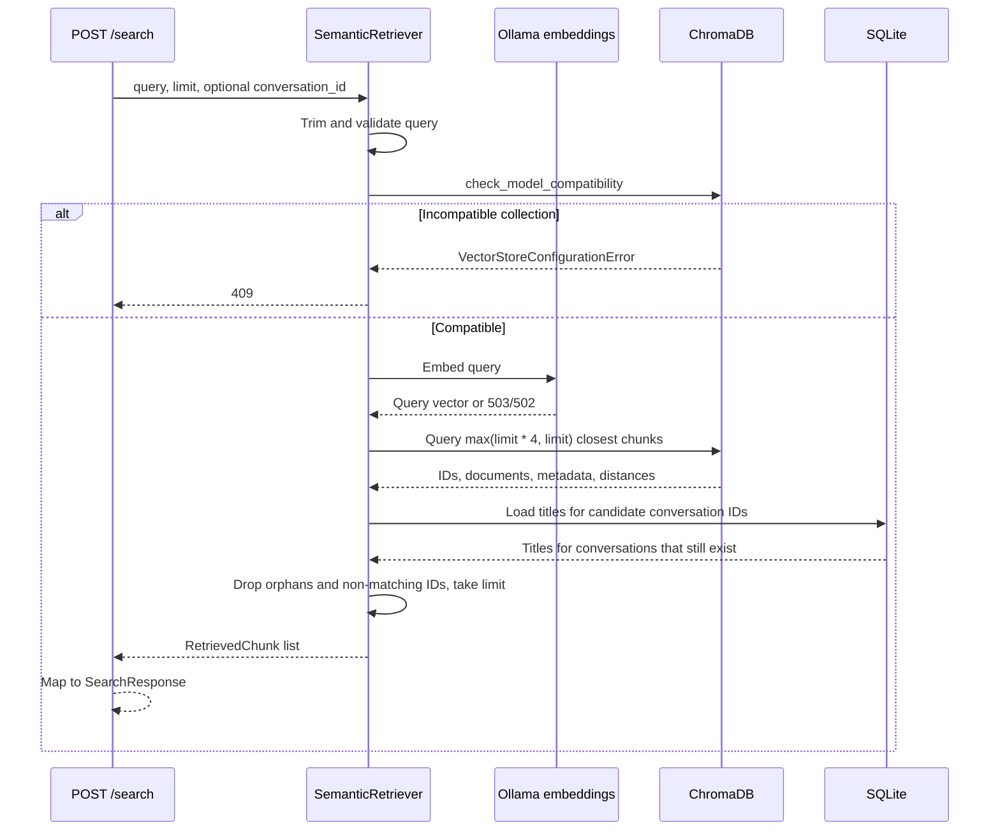
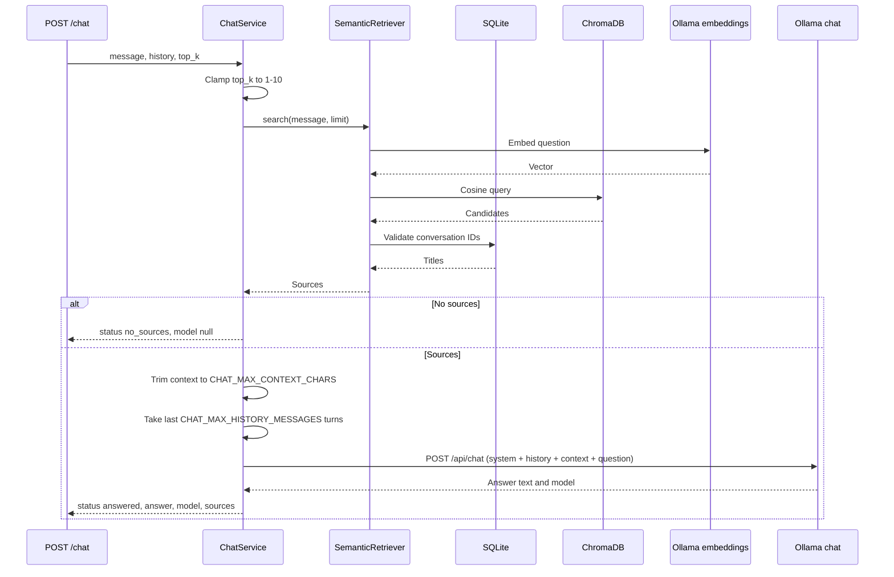
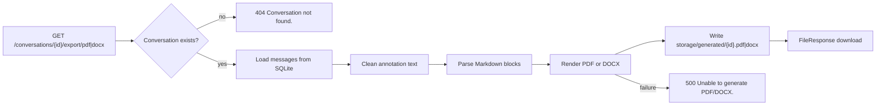
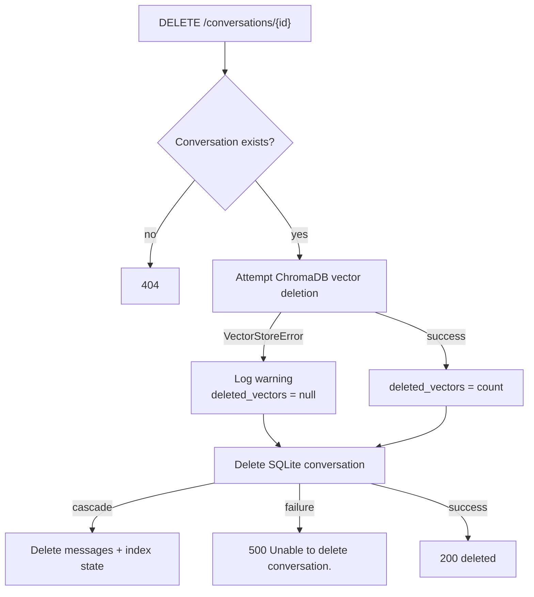

# Data Flow

Every ChatVault AI operation starts in the React frontend or a direct API call
and ends in SQLite, ChromaDB, generated files, or a model response. This page
traces the four main flows.

## Import flow

The frontend then issues a separate indexing request. A failed index does not
roll back the import.

## Indexing flow

Key invariants:

- Old vectors are deleted only after all new embeddings have been generated.
- A failed write triggers a best-effort cleanup of the conversation's vectors.
- The index signature is
  `<embedding_model>|<chunking_version>|<size>|<overlap>|<min>`.
- A conversation is `already_indexed` only if the signature matches **and** the
  live ChromaDB count matches the recorded chunk count.

## Search flow

## Chat flow

The response's `sources` are the exact chunks included in the prompt after
context trimming, not every candidate returned by ChromaDB. Source numbering
starts at 1 in the response.

## Export flow

Exports do not call Ollama or ChromaDB. They read SQLite only.

## Deletion flow

SQLite deletion is authoritative. If vector cleanup fails, stale vectors remain
but are not returned by search because retrieval checks conversation IDs against
SQLite.

## Index rebuild flow

1. Acquire the indexing lock.
2. Verify the embedding model is installed.
3. Delete and recreate the ChromaDB collection.
4. Reset every index state to `not_indexed` and clear signatures and chunk counts.
5. Index every conversation with `force=True`.
6. Return a per-conversation result list.

If the library is empty, the rebuild returns `nothing_to_do` after resetting the
collection.

## Related pages

- [Architecture](architecture.md)
- [RAG Explained](rag-explained.md)
- [Vector Search](vector-search.md)
- [Indexing API](../api-reference/indexing.md)
