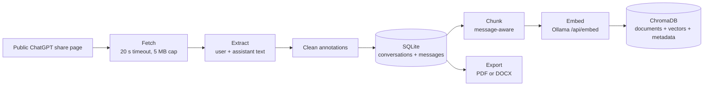

# Document Processing

ChatVault AI processes text in one direction: an imported conversation is cleaned,
stored, chunked, embedded, and later retrieved. Exports run a separate rendering
path from the same stored text.

This page explains what happens to a message and where the current implementation
stops.

## Pipeline



The only network calls in this pipeline are the import fetch (to `chatgpt.com`)
and the Ollama embedding request. Chunking, storage, and export are local.

## 1. Fetching

`app/ingestion/fetcher.py` fetches the public share page with these hard limits:

| Limit | Value |
| --- | --- |
| Request timeout | 20 seconds |
| Maximum response body | 5 MB |
| Maximum redirects | 3 |
| Accepted content types | `text/html`, `application/xhtml+xml` |
| Allowed host | `chatgpt.com` |
| Allowed scheme | HTTPS |

Redirects are followed manually so each target can be revalidated. A redirect to
another host, a non-HTML response, or an oversized body is rejected.

## 2. Extraction

The extractor supports two page formats:

1. **Serialized ChatGPT payload** inside a script containing `.enqueue(`. The
   extractor resolves the serialized references, reads the conversation mapping,
   follows `linear_conversation`, and keeps only `user` and `assistant` messages
   whose content type is `text`.
2. **Legacy HTML fallback** using elements with
   `data-message-author-role="user"` or `data-message-author-role="assistant"`.

Messages with other roles, tool output, thoughts, reasoning recaps, images, and
non-text parts are excluded. The conversation title comes from the payload when
available, otherwise from the HTML `<title>`.

Extraction is deliberately strict: a page with no supported text messages fails
with `Unable to extract conversation: ...` rather than storing an empty record.

## 3. Annotation cleaning

ChatGPT uses private-use Unicode annotations for links and entities. The cleaner
in `app/processing/text_cleaner.py` handles them before text is stored or used:

| Annotation | Result |
| --- | --- |
| `url` | The readable title, or the URL when no title is present |
| `entity` | The first non-empty string value in the entity payload |
| `genui`, `image_group`, unknown kinds | Removed |
| Residual private-use characters | Removed |

Normal Markdown is preserved. Cleaning runs during extraction, conversation
detail responses, chunking, retrieval, and export, so annotations do not leak into
answers or documents.

## 4. Chunking

Chunking is **message-aware**: a chunk never contains text from two different
messages. This keeps every retrieved passage attributable to one speaker and one
message position.

The algorithm in `app/processing/chunker.py`:

1. Sorts messages by `position`.
2. Cleans and trims each message.
3. Splits the message into paragraphs, headings, list items, and fenced code
   blocks.
4. Splits oversized units at line, sentence, then whitespace boundaries.
5. Re-fences oversized code blocks so each piece remains valid-looking Markdown.
6. Packs units into chunks up to the configured size.
7. Adds overlap from the previous chunk **within the same message**.
8. Merges a tiny final chunk into its predecessor when it fits.

### Size model

Token counts are deterministic approximations, not tokenizer output:

```text
estimated_tokens = ceil(characters / 4)
```

The API reports this as `token_counting: "approximate_char4"`. Chunk IDs use:

```text
<conversation_id>:<message_position>:<chunk_index>
```

Defaults:

| Setting | Default | Meaning |
| --- | --- | --- |
| `CHUNK_SIZE_TOKENS` | `500` | Target maximum, about 2,000 characters |
| `CHUNK_OVERLAP_TOKENS` | `75` | About 300 characters of overlap |
| `CHUNK_MIN_TOKENS` | `30` | Tiny-tail merge threshold |
| `CHUNKING_VERSION` | `message-aware-v1` | Included in the index signature |

Changing any of these changes the index signature. Existing conversations become
**stale** until reindexed.

## 5. Embedding

Each chunk is embedded with a small header that gives the model context:

```text
Conversation: <title>
Speaker: <role>

<chunk text>
```

The header is sent to Ollama but is **not** stored as the ChromaDB document. The
stored document is the chunk text alone, which is what search returns.

Texts are embedded in batches of `OLLAMA_EMBED_BATCH_SIZE` (default 16). The
client validates that every vector is numeric, finite, and consistent in
dimension. See [Embeddings](../concepts/embeddings.md).

## 6. Vector storage

ChromaDB stores three things per chunk:

- The chunk ID.
- The chunk text as the document.
- Metadata: conversation ID, database ID, message ID and position, role, chunk
  index, title, chunking version, and embedding model.

The collection uses cosine distance. Embedding model and dimension are recorded
in collection metadata so incompatible vectors can be detected. See
[Vector Search](../concepts/vector-search.md).

## 7. Export rendering

PDF and DOCX export read messages from SQLite and parse a practical Markdown
subset:

- Headings, paragraphs, bullet and numbered lists.
- Task lists, block quotes, fenced code blocks.
- Pipe tables and horizontal rules.
- Inline code, bold, and italic.

PDF uses ReportLab and DejaVu fonts from
`/usr/share/fonts/truetype/dejavu`. DOCX uses python-docx and does not need those
font files. Neither exporter is a full CommonMark renderer: nested structures,
raw HTML, images, and footnotes are not rendered as rich content.

## What is not processed

- Attachments and images from the share page.
- Non-text message parts.
- Private conversations.
- HTML from arbitrary domains.
- Multiple conversations per import request.
- Incremental or background processing. Import, indexing, rebuilds, and exports
  all run inside the request.

## Related pages

- [Importing ChatGPT URLs](importing-chatgpt-urls.md)
- [Embeddings](../concepts/embeddings.md)
- [Vector Search](../concepts/vector-search.md)
- [Export](../user-guide/export.md)
