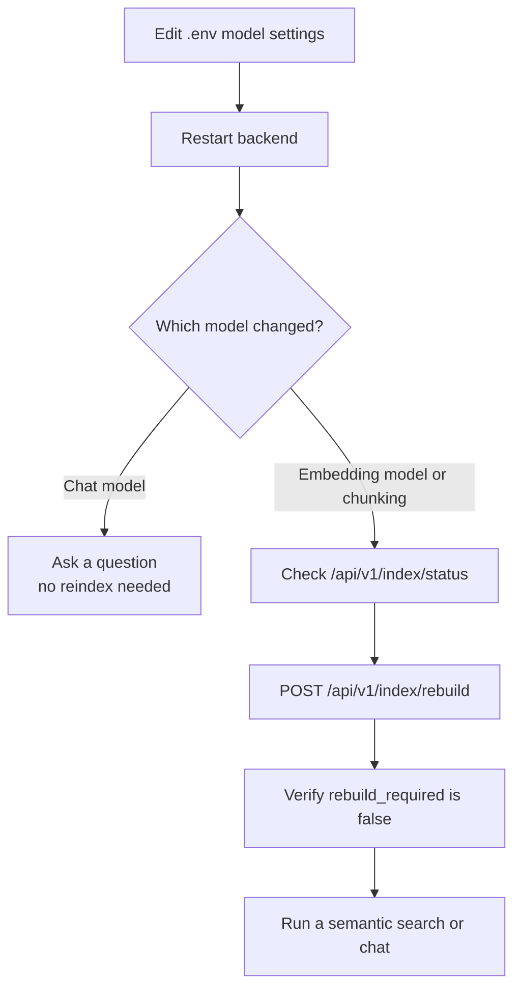

# Model Configuration

ChatVault AI uses two Ollama models with different responsibilities. Changing
one has different consequences for the stored index.

| Role | Variable | Default | Used by |
| --- | --- | --- | --- |
| Embeddings | `OLLAMA_EMBED_MODEL` | `nomic-embed-text` | Indexing and semantic retrieval |
| Chat | `OLLAMA_CHAT_MODEL` | `llama3.2:3b` | Answer generation after retrieval |

## Change the chat model

1. Pull the model:

    ```bash
    ollama pull <chat-model>
    ```

2. Set the variable in the root `.env`:

    ```dotenv
    OLLAMA_CHAT_MODEL=<chat-model>
    ```

3. Restart the backend.
4. Check **Settings** or `GET /api/v1/models/status`.

No index rebuild is required. Stored vectors are independent of the chat model.
The next chat request uses the new model.

## Change the embedding model

Changing the embedding model invalidates every stored vector. The collection's
provenance metadata must match the configured model and dimension.

1. Pull the new model:

    ```bash
    ollama pull <embedding-model>
    ```

2. Set the variable:

    ```dotenv
    OLLAMA_EMBED_MODEL=<embedding-model>
    ```

3. Restart the backend.
4. Rebuild the index:

    ```bash
    curl -X POST http://127.0.0.1:8000/api/v1/index/rebuild
    ```

Until the rebuild finishes, indexing and search return HTTP `409` with a message
such as `The embedding model has changed. Rebuild the index.`

## Model name matching

Ollama reports installed models with tags. ChatVault treats a configured name as
installed when:

```text
installed == configured
```

or:

```text
installed starts with "<configured>:"
```

So a configured `llama3.2` matches an installed `llama3.2:latest`. Prefer
explicit tags for reproducibility.

## Embedding settings

| Variable | Default | Range | Effect |
| --- | --- | --- | --- |
| `OLLAMA_EMBED_TIMEOUT` | `120` | `> 0` | HTTP timeout per batch |
| `OLLAMA_EMBED_BATCH_SIZE` | `16` | `1`-`128` | Texts per `/api/embed` request |

Larger batches reduce request overhead but increase memory use and the impact of
a timeout. The client validates that every returned vector is numeric, finite,
and has a consistent dimension.

The collection records the embedding model and dimension in its metadata. A
mismatch returns HTTP `409` until you rebuild.

## Chat settings

| Variable | Default | Range | Effect |
| --- | --- | --- | --- |
| `OLLAMA_CHAT_TIMEOUT` | `180` | `> 0` | Generation timeout |
| `OLLAMA_CHAT_TEMPERATURE` | `0.2` | `0`-`2` | Sampling temperature |
| `CHAT_TOP_K` | `5` | `1`-`10` | Default retrieved chunks |
| `CHAT_MAX_HISTORY_MESSAGES` | `10` | `0`-`50` | Recent turns included |
| `CHAT_MAX_CONTEXT_CHARS` | `12000` | `1000`-`100000` | Approximate context budget |

The chat request also accepts `top_k`, validated to 1-10 and clamped again in
`ChatService`. The frontend always sends `top_k: 5`.

A higher temperature produces more varied answers; it does not improve retrieval
quality. A larger `top_k` adds more context but can dilute the prompt and increase
latency.

## Chunking settings

| Variable | Default | Range | Notes |
| --- | --- | --- | --- |
| `CHUNK_SIZE_TOKENS` | `500` | `50`-`2000` | Approximate tokens, four characters per token |
| `CHUNK_OVERLAP_TOKENS` | `75` | `>= 0`, `< size` | Overlap within one message |
| `CHUNK_MIN_TOKENS` | `30` | `>= 0`, `<= size` | Tiny tail merge threshold |
| `CHUNKING_VERSION` | `message-aware-v1` | non-empty | Part of the index signature |

These values affect chunk boundaries and therefore retrieval. They are part of
the index signature. Existing conversations become **stale** when the signature
changes and can be reindexed. A full rebuild is the simplest way to apply new
chunking settings everywhere.

## Recommended workflow for model changes



## What is not configurable

- Multiple embedding models in one collection.
- Per-conversation model selection.
- Hosted model providers.
- Streaming or tool-calling options.
- Model download from the UI.
- Model generation parameters beyond temperature.

## Related pages

- [Ollama Setup](ollama-setup.md)
- [Configuration](../getting-started/configuration.md)
- [Embeddings](../concepts/embeddings.md)
- [Indexing API](../api-reference/indexing.md)
