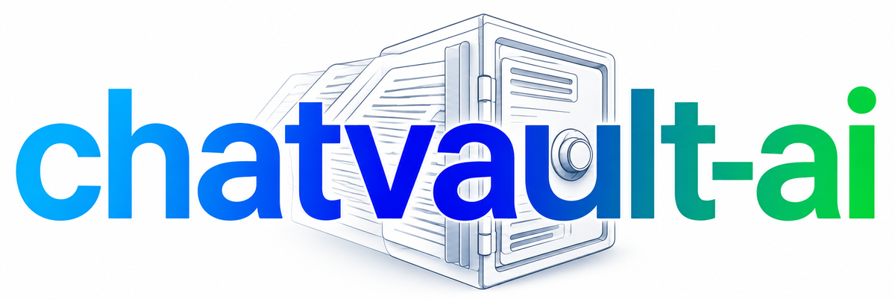
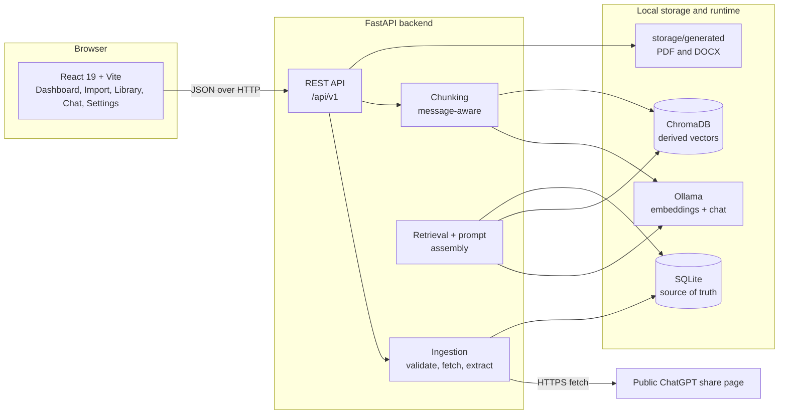

<div class="cv-hero" markdown>

<span class="cv-hero__eyebrow">Local-first conversation knowledge base</span>



# Your conversations. Your knowledge. Your control.

ChatVault AI transforms public ChatGPT conversations into a local, searchable
knowledge base with SQLite storage, PDF/DOCX export, Ollama embeddings, and
retrieval-augmented chat that cites its sources.

[Get started](getting-started/index.md){ .md-button .md-button--primary }
[Quickstart](getting-started/quickstart.md){ .md-button }
[GitHub repository](https://github.com/heyshreee/chatvault-ai){ .md-button }

</div>

<figure class="cv-demo" markdown>
  
  <figcaption>Import a public share link, index it locally, ask a question with cited sources, and export the transcript.</figcaption>
</figure>

## Why ChatVault AI

ChatVault AI is built around one rule: **SQLite is the source of truth, and the
vector index is disposable.** Conversations and messages are stored locally in
SQLite. The ChromaDB collection can be deleted and rebuilt from SQLite at any
time. Chat and embeddings run against a local Ollama instance, so conversation
text is not sent to a hosted model.

<div class="cv-grid" markdown>

<div class="cv-card" markdown>
### Import public shares
Fetch a public `chatgpt.com/share` URL, extract the message tree, and store it
locally with duplicate detection.
</div>

<div class="cv-card" markdown>
### Export real documents
Download a styled PDF or an editable DOCX with headings, lists, tables, quotes,
task lists, and fenced code blocks.
</div>

<div class="cv-card" markdown>
### Search with embeddings
Chunk conversations by message, embed them through Ollama, and query the closest
passages with ChromaDB cosine search.
</div>

<div class="cv-card" markdown>
### Ask with citations
Retrieve context, ask the local chat model, and show the numbered source chunks
behind every answer.
</div>

</div>

## Feature status

The status column describes the code in the `v1.0.0` release. Features marked
**API only** exist in the backend but do not have a dedicated screen in the React
frontend.

| Capability | Status | Notes |
| --- | --- | --- |
| Public ChatGPT share URL import | Implemented | `chatgpt.com/share/<id>` only; no login, ZIP upload, or private chats |
| SQLite conversation and message storage | Implemented | Source of truth; duplicate imports return the existing record |
| Conversation library and viewer | Implemented | Title filter, date/message filters, sorting, delete, Markdown transcript |
| PDF and DOCX export | Implemented | Per conversation, from the viewer or API |
| Message-aware chunking | Implemented | Chunks never cross message boundaries |
| Ollama embeddings and ChromaDB index | Implemented | Explicit embeddings only; cosine distance |
| Per-conversation and bulk indexing | Implemented | Synchronous; single process-wide indexing lock |
| Index status, delete, and rebuild | Implemented | Rebuild recreates the ChromaDB collection |
| Semantic search | Implemented | `POST /api/v1/search`; no dedicated frontend search screen |
| Retrieval-augmented chat | Implemented | Cited sources; no-source path skips the chat model |
| Dashboard and system status | Implemented | SQLite counts, index coverage, Ollama and ChromaDB health |
| Authentication and multi-user access | Not implemented | Single-user local application; bind to loopback |
| Background jobs and streaming | Not implemented | Requests run synchronously; chat is non-streaming |
| ChatGPT data-export ZIP import | Not implemented | Only public share URLs are supported |
| Hosted model providers | Not implemented | Ollama is the only model runtime |
| Automated backup scheduling | Not implemented | Back up `storage/chatvault.db` manually |

## Architecture at a glance



The backend is the only component that talks to ChatGPT, Ollama, SQLite, and
ChromaDB. The browser talks to the backend over JSON and downloads generated
documents. See [Architecture](concepts/architecture.md) for component
responsibilities and failure boundaries.

## Technology stack

| Layer | Technology | Role in ChatVault AI |
| --- | --- | --- |
| Frontend | React 19, TypeScript, Vite 8 | Six-page local workspace |
| UI | Tailwind CSS 4, TanStack Query 5, React Router 7 | Layout, data fetching, routing |
| Markdown | react-markdown, remark-gfm, prism-react-renderer | Transcript and answer rendering with code highlighting |
| API | FastAPI, Pydantic v2, Uvicorn | REST endpoints and request validation |
| Database | SQLAlchemy 2, SQLite | Conversations, messages, and index state |
| Ingestion | httpx, BeautifulSoup | Share-page fetching and message extraction |
| Embeddings | Ollama, `nomic-embed-text` | Local vector generation |
| Vector store | ChromaDB 1.5.9 | Persistent cosine-distance collection |
| Chat | Ollama, `llama3.2:3b` | Local retrieval-augmented generation |
| Documents | ReportLab, python-docx | PDF and DOCX rendering |
| Tests | pytest, oxlint, TypeScript build | Backend contracts and frontend checks |

## Run it locally

```bash
# 1. Install backend and frontend dependencies
make install

# 2. Pull the default local models
ollama pull nomic-embed-text
ollama pull llama3.2:3b

# 3. Start the backend
make run

# 4. In a second terminal, start the frontend
cd frontend && npm run dev
```

Open <http://127.0.0.1:5173>. The API and Swagger UI are available at
<http://127.0.0.1:8000/docs>.

The full path, including manual `uv` and `npm` commands, is in
[Installation](getting-started/installation.md). Configuration defaults and
constraints are in [Configuration](getting-started/configuration.md).

## Documentation map

| Section | Start here |
| --- | --- |
| Install and configure | [Getting Started](getting-started/index.md) |
| Use the application | [User Guide](user-guide/dashboard.md) |
| Set up Ollama and models | [Guides](guides/ollama-setup.md) |
| Understand the design | [Concepts](concepts/architecture.md) |
| Call the REST API | [API Reference](api-reference/overview.md) |
| Contribute or release | [Development](development/project-structure.md) |

## Project links

- [GitHub repository](https://github.com/heyshreee/chatvault-ai)
- [Upstream repository](https://github.com/makitdev/chatvault-ai)
- [Issue tracker](https://github.com/heyshreee/chatvault-ai/issues)
- [Contributing guide](development/contributing.md)
- [Security policy](concepts/privacy-and-security.md)
- [Release notes v1.0.0](releases/v1.0.0.md)

ChatVault AI is licensed under the
[GNU General Public License v3.0](https://github.com/heyshreee/chatvault-ai/blob/main/LICENSE).
